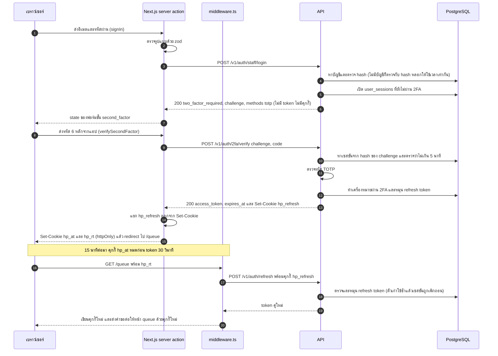
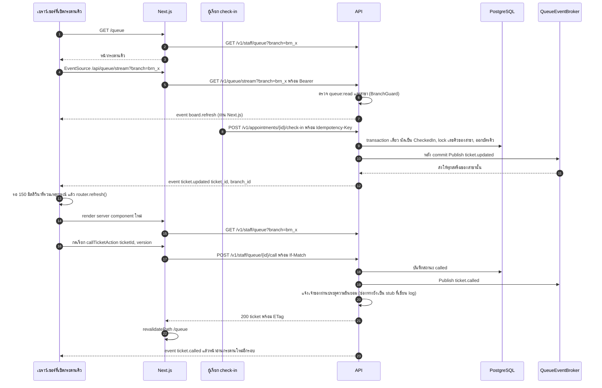
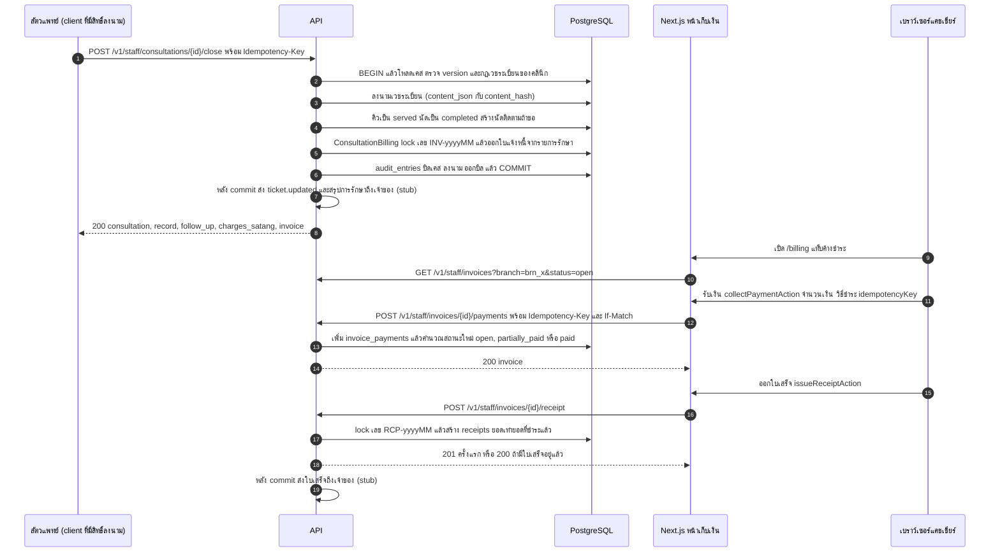

# สถาปัตยกรรม

เอกสารนี้อธิบายว่าระบบประกอบด้วยอะไร คำขอหนึ่งเดินผ่านอะไรบ้าง ข้อมูลเก็บที่ไหน และทำไมจึงออกแบบแบบนี้ สัญญา API คือไฟล์ `API Reference.dc.html` ที่ root เอกสารนี้ไม่เล่าซ้ำ ส่วนว่าอะไรทำเสร็จแล้วบ้างดูที่ [ภาพรวมระบบ](system-overview.md)

## ภาพรวม

```text
เบราว์เซอร์
   │  https, ถือแค่คุกกี้ httpOnly ของหน้าเว็บ (hp_at, hp_rt, hp_branch)
   ▼
หน้าเว็บ Next.js 15 (frontend/, พอร์ต 3000)
   │  server component, server action, route handler /api/queue/stream
   │  แนบ Bearer token แล้วเรียก API จากฝั่งเซิร์ฟเวอร์เท่านั้น
   ▼
API ASP.NET Core 10 (backend/src/HappyPaws.Api, พอร์ต 5080, path base /v1)
   │  controller → handler (Application) → domain → repository (Infrastructure)
   ▼
PostgreSQL 17 ฐานข้อมูลเดียวของคลินิก
```

**หนึ่งคลินิกคือหนึ่ง deployment** ตามที่สัญญาเขียนไว้ว่า "หนึ่งคลินิก = หนึ่ง instance แยกขาด" จึงไม่มี `clinic_id` ใน path ไม่มีคอลัมน์ tenant และไม่มีผู้ดูแลแพลตฟอร์ม การแยกข้อมูลระหว่างคลินิกทำด้วยการแยกเครื่อง ส่วนสาขา (`brn_...`) เป็นแค่ขอบเขตการทำงานภายในคลินิกเดียว

## ส่วนที่ 1: หน้าเว็บ (BFF)

Next.js ทำหน้าที่ 3 อย่าง

1. **แสดงหน้าจอ** หน้าพนักงานเป็น server component ที่อ่านข้อมูลจาก API ใหม่ทุกครั้งที่ render (`app/(staff)/layout.tsx` ตั้ง `dynamic = 'force-dynamic'`) client component มีเฉพาะส่วนที่ต้องโต้ตอบ และรับข้อมูลจาก server component ไม่ดึงเอง
2. **ถือ token แทนเบราว์เซอร์** access token อยู่ในคุกกี้ `hp_at` และ refresh token อยู่ใน `hp_rt` ทั้งคู่เป็น httpOnly script บนหน้าเว็บอ่านไม่ได้ การแก้ข้อมูลทุกอย่างเป็น server action ที่อ่านคุกกี้ แนบ `Authorization: Bearer` แล้วเรียก API
3. **ต่ออายุเซสชันก่อนทุกหน้า** `src/middleware.ts` ทำงานกับ `/login`, `/queue`, `/billing` และ `/api/queue/*` ถ้าคุกกี้ `hp_at` หมดแต่ยังมี `hp_rt` จะขอ token คู่ใหม่ เขียนคุกกี้ใหม่ และแก้ header ของคำขอนั้นให้หน้าเห็นคุกกี้ใหม่ทันที

เบราว์เซอร์จึงไม่เคยคุยกับ API ตรง แม้แต่หน้าแรกสาธารณะก็ไม่เรียก API เพราะเป็นเนื้อหาคงที่ ตัวแปร `NEXT_PUBLIC_API_BASE_URL` ยังประกาศไว้ใน `next.config.ts` และ `src/config/env.ts` แต่ตอนนี้ไม่มีโค้ดใช้

หน้าเว็บซ่อนปุ่มตาม scope ได้ (`src/lib/auth/scopes.ts`) แต่ไม่ใช่ด่านป้องกัน สิทธิ์ทุกอย่างตรวจที่ API รายละเอียดอยู่ใน [การเข้าสู่ระบบ](authentication.md) และ [สิทธิ์](authorization.md)

## ส่วนที่ 2: API

### เส้นทางของคำขอ

ลำดับใน `backend/src/HappyPaws.Api/Program.cs` มีผลกับความถูกต้อง ห้ามสลับโดยไม่เข้าใจเหตุผล

```text
Kestrel
  └─ UsePathBase("/v1")            ตัด /v1 ออก path ที่ไม่มี /v1 ก็ยังผ่าน
       └─ UseExceptionHandler        แปลงทุก exception เป็น error envelope ของสัญญา
            └─ RequestContextMiddleware   ใส่ request id ให้ทุกคำตอบและ log
                 └─ UseCors
                      └─ UseAuthentication      ตรวจ JWT
                           └─ UseRateLimiter        แบ่งตาม subject ของ token ถ้าไม่มี token ใช้ IP
                                └─ UseAuthorization     ต้องเข้าสู่ระบบเป็นค่าตั้งต้น, [RequireScope] ตรวจ scope และ 2FA
                                     └─ IdempotencyMiddleware   เฉพาะ action ที่มี [Idempotent]
                                          └─ controller → handler
```

- rate limiter อยู่หลัง authentication เพราะต้องรู้ว่าใครเรียกก่อน ถ้าอยู่ก่อน ทุกคำขอจะถูกนับตาม IP และทั้งคลินิกที่ออกเน็ตผ่าน IP เดียวจะโดนจำกัดพร้อมกัน
- idempotency อยู่หลัง authorization เพราะ key ผูกกับบัญชี และคำขอที่ไม่มีสิทธิ์ต้องไม่ได้จอง key
- endpoint ที่ไม่ใส่ `[AllowAnonymous]` ต้องเข้าสู่ระบบเสมอ (`FallbackPolicy` ใน `Extensions/AuthorizationExtensions.cs`) ลืมใส่ attribute จึงกลายเป็นปิด ไม่ใช่เปิด
- โหมด Development เปิดเอกสาร OpenAPI ด้วย `MapOpenApi()` (ค่าตั้งต้นคือ `/openapi/v1.json`) ซึ่งไม่ได้ใส่ `AllowAnonymous` จึงต้องมี token เหมือน endpoint อื่น ส่วนโหมดอื่นเปิด HTTPS redirect และ HSTS

### ชั้นของโค้ด

| โปรเจกต์ | หน้าที่ | อ้างอิงได้ |
|---|---|---|
| `HappyPaws.Domain` | entity, value object, state machine, กฎที่อยู่กับข้อมูล | ไม่มี |
| `HappyPaws.Application` | use case (handler), DTO, validator, interface ของสิ่งภายนอก | Domain |
| `HappyPaws.Infrastructure` | EF Core, repository, JWT, TOTP, ตัวส่งข้อความ, SSE broker | Application |
| `HappyPaws.Api` | controller, middleware, auth, OpenAPI, คำสั่ง operator | Application, Infrastructure |

`HappyPaws.Domain.csproj` ไม่มี `PackageReference` เลย Domain จึงพึ่ง ASP.NET Core หรือ EF Core ไม่ได้ Api อ้าง Infrastructure เพื่อเรียก `AddInfrastructure()` ตอนเริ่มเท่านั้น controller ไม่ใช้ type ของ Infrastructure รายละเอียดโฟลเดอร์อยู่ใน [โครงสร้างโค้ด](code-structure.md)

### handler หนึ่งตัวทำอะไร

handler เป็นคลาสธรรมดาที่ลงทะเบียนใน DI และ controller เรียกตรง ไม่มี MediatR ไม่มี service รวมของโมดูล ลำดับในแต่ละ use case ที่เขียนข้อมูลคือ

1. ตรวจ input ด้วย `RequestValidator` (FluentValidation)
2. เปิด `IUnitOfWork.ExecuteInTransactionAsync` แล้ว **โหลดข้อมูลข้างใน callback**
3. ตรวจสิทธิ์ระดับข้อมูล เช่น `BranchGuard`, `PetAccessGuard`, `QueueAccess`
4. `ConcurrencyGuard.Ensure` เทียบ `If-Match` กับ version ที่โหลดมา
5. เรียก method ของ domain ให้เปลี่ยนสถานะ
6. `IAuditTrail.Record` ซึ่งเข้าร่วม transaction เดียวกัน
7. commit แล้วจึงส่งเหตุการณ์ SSE และข้อความถึงลูกค้า

## ส่วนที่ 3: ข้อมูล

ฐานข้อมูลเดียวคือ PostgreSQL ผ่าน EF Core 10 กับ Npgsql โครงสร้างมาจาก migration ใน `HappyPaws.Infrastructure/Persistence/Migrations/` ไม่มี SQL ที่เขียนมือแยกไว้ กฎบางข้อที่ต้องกันการเขียนพร้อมกันอยู่ในฐานข้อมูลเอง เช่น constraint กันจองเวลาซ้อน และ advisory lock ตอนออกเลขคิวและเลขเอกสาร รายละเอียดอยู่ใน [ฐานข้อมูล](database.md)

## ส่วนที่ 4: งานหลัง commit

ระบบยังไม่มีงานเบื้องหลังเลย (ไม่มี hosted service ไม่มีตาราง outbox) สิ่งที่ต้องเกิดหลังบันทึกทำใน request เดียวกัน หลัง commit

- **เหตุการณ์คิว** `IQueueEventStream.Publish` ไม่ throw และไม่รอ ผู้ฟังที่ช้าทำให้การเรียกคิวช้าไม่ได้
- **ข้อความถึงลูกค้า** ผ่าน `INotificationDispatcher` ตัวเดียวที่มีคือ `ConsentAwareNotificationDispatcher` ซึ่งตรวจความยินยอมก่อนส่ง ถ้าส่งไม่สำเร็จจะ log แต่ไม่ทำให้คำขอล้ม

ข้อแลกเปลี่ยนคือถ้า process ดับระหว่าง commit กับการส่ง ข้อความนั้นหายไป แต่คิวที่ถูกเรียกหรือใบเสร็จที่ออกแล้วยังถูกต้อง ดูเพิ่มที่ [การแจ้งเตือน](features/notifications.md)

## ส่วนที่ 5: การอัปเดตสด

กระดานคิวฟัง SSE ที่ `/queue/stream` ผ่าน route handler ของ Next.js เหตุการณ์บอกแค่ว่ามีอะไรเปลี่ยน หน้าเว็บจึงอ่านกระดานใหม่ผ่าน REST เหมือนเดิม รายละเอียดใน [การอัปเดตสด](realtime.md)

## ส่วนที่ 6: บริการภายนอก

| บริการ | สถานะ | โค้ด |
|---|---|---|
| LINE, SMS, อีเมลถึงลูกค้า | ยังไม่มี ใช้ `LoggingNotificationChannel` เขียน log ระดับ warning แทน | `Infrastructure/Notifications/` (โฟลเดอร์ `Line`, `Sms`, `Email` ว่าง) |
| อีเมลเชิญพนักงาน | ยังไม่มี ใช้ `LoggingStaffInvitationSender` ในโหมด dev เขียนลิงก์ลง log ได้ | `Infrastructure/Staff/` |
| payment gateway | ยังไม่มี การรับบัตรคือบันทึกเลขสลิปใน `reference` | ไม่มี |
| แล็บภายนอก, ที่เก็บไฟล์, webhook ขาออก | ยังไม่มี | โฟลเดอร์ว่างใน `Infrastructure/` |

## การตัดสินใจสำคัญ

| เรื่อง | เลือกแบบนี้ | เหตุผล |
|---|---|---|
| รูปแบบระบบ | modular monolith API ตัวเดียว ฐานข้อมูลเดียว | หนึ่งคลินิกหนึ่ง instance ไม่มีเหตุให้แยก service |
| ที่เก็บ token | คุกกี้ httpOnly บนเซิร์ฟเวอร์ Next.js | script ในหน้าเว็บขโมย token ไม่ได้ และ `EventSource` ก็ส่ง header เองไม่ได้อยู่แล้ว |
| การอัปเดตสด | SSE ส่งแค่สัญญาณ แล้วอ่านกระดานใหม่ | กติกาสิทธิ์และลำดับคิวอยู่ที่ API ที่เดียว หน้าจอไม่ต้องเก็บสำเนาคิวเอง |
| ลำดับคิว | เรียงที่ API ใน query เดียว | กระดานที่เคาน์เตอร์กับ "เหลืออีกกี่คิว" ของเจ้าของต้องตรงกันเสมอ |
| ใบแจ้งหนี้จากการปิดเคส | ออกใน transaction เดียวกับการลงนามเวชระเบียน | เคสที่ปิดแล้วต้องมีบิล หรือไม่มีอะไรเกิดขึ้นเลย |
| migration | สั่งเองด้วย `migrate` ไม่รันตอนเปิด API | instance ที่ migrate เองตอนเปิดอาจไปเปลี่ยนโครงสร้างกลางวันทำการ |
| งานของผู้ดูแลเครื่อง | คำสั่ง operator ไม่ใช่ endpoint | การสร้างเจ้าของคนแรกหรือรีเซ็ตรหัสผ่านโดยไม่รู้รหัสเดิมต้องไม่มีทางทำผ่าน HTTP |
| version สำหรับ `If-Match` | คอลัมน์ระบบ `xmin` ของ PostgreSQL | ฐานข้อมูลดูแลเอง ไม่มี trigger ไม่มีการบวกเลขด้วยมือ |
| ข้อความถึงลูกค้า | port เดียวที่ผ่านประตูความยินยอม | use case ไม่มีทางส่งข้อความโดยข้ามการตรวจความยินยอม |

## ข้อจำกัดที่รู้อยู่

- รัน API หรือ Next.js มากกว่าหนึ่งตัวไม่ได้ SSE broker (`QueueEventBroker`) และตัวกันการ refresh ซ้ำ (`src/lib/auth/refresh-session.ts`) อยู่ในหน่วยความจำของ process เดียว
- ไม่มีงานเบื้องหลัง ข้อความที่ส่งไม่สำเร็จไม่ถูกส่งซ้ำ แถวใน `idempotency_records` ที่หมดอายุไม่มีใครลบ และยังไม่มีการเตือนนัดล่วงหน้า
- ช่องทาง LINE, SMS, อีเมล และ payment gateway ยังเป็น stub ตามตารางด้านบน
- ค่าใน `appsettings.json` หมวด `Auth` ที่ใช้จริงมีแค่ `Auth:Jwt` ส่วน `RefreshTokenLifetimeDays`, `StaffInvitationLifetimeDays`, `BookingHoldLifetimeMinutes` และตัวอื่นไม่มีโค้ดอ่าน อายุจริงฝังอยู่ใน Domain เช่น `UserSession.Lifetime` 30 วัน
- challenge ที่ได้จาก `POST /auth/staff/login` คือ refresh token ของเซสชันที่ยังไม่ผ่าน 2FA `POST /auth/refresh` ปฏิเสธเซสชันแบบนี้แล้ว แต่การแยก challenge เป็นค่าของตัวเองจะปลอดภัยกว่า ดู [การเข้าสู่ระบบ](authentication.md)

## ลำดับการทำงานสำคัญ

### พนักงานเข้าสู่ระบบด้วยรหัสผ่านและ 2FA จนได้คุกกี้



### จากเช็กอินถึงเรียกคิว และกระดานคิวอัปเดตสด

ยังไม่มีหน้าจอเช็กอินบนเว็บ ผู้เรียก `check-in` ในภาพจึงเป็น client ใดก็ได้ที่ถือ token ที่มี `appointment:checkin` หรือลูกค้าที่ดูแลสัตว์ตัวนั้น



### ปิดเคส ออกใบแจ้งหนี้ รับเงิน และออกใบเสร็จ

หน้าปิดเคสบนเว็บยังไม่มีเช่นกัน ส่วนหน้าเก็บเงิน (`/billing`) ทำแล้ว



รายละเอียดของแต่ละขั้นอยู่ใน [คิว](features/queue.md), [การตรวจและเวชระเบียน](features/consultations-and-records.md) และ [การเงิน](features/billing.md) ส่วน `GET /staff/invoices` เป็น endpoint ส่วนขยาย ดู [endpoint ส่วนขยาย](contract-extensions.md)

## โค้ดที่เกี่ยวข้อง

| ไฟล์ | หน้าที่ |
|---|---|
| `backend/src/HappyPaws.Api/Program.cs` | ลำดับ middleware และจุดแยกไปคำสั่ง operator |
| `backend/src/HappyPaws.Api/Extensions/` | ตั้งค่า authentication, authorization, rate limit, OpenAPI |
| `backend/src/HappyPaws.Application/DependencyInjection.cs` | ลงทะเบียนโมดูลของ Application |
| `backend/src/HappyPaws.Infrastructure/DependencyInjection.cs` | ลงทะเบียน DbContext, repository และ adapter ทั้งหมด |
| `backend/src/HappyPaws.Infrastructure/Persistence/UnitOfWork.cs` | ขอบเขต transaction และการ retry |
| `frontend/src/middleware.ts` | ต่ออายุเซสชันก่อนทุกหน้า |
| `frontend/src/lib/api/` | ที่เดียวที่เรียก `fetch` ไปหา API |
