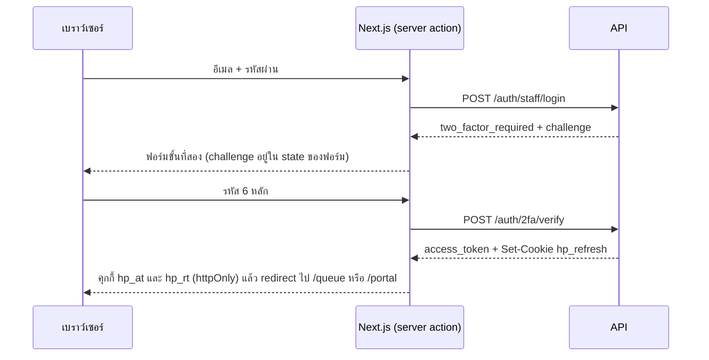

# การเข้าสู่ระบบและเซสชัน

เอกสารนี้บอกว่าผู้เรียก API พิสูจน์ตัวตนอย่างไร ได้ token อะไร เซสชันอยู่ได้นานแค่ไหน และหน้าเว็บถือ token อย่างไร ส่วนเรื่องว่าเข้ามาแล้วทำอะไรได้บ้างอยู่ใน [สิทธิ์และการให้สิทธิ์](authorization.md) ภาพรวมความปลอดภัยและข้อจำกัดทั้งหมดอยู่ใน [ความปลอดภัย](security/README.md)

## ใครเข้าสู่ระบบได้ตอนนี้

- **พนักงาน** เข้าสู่ระบบด้วยอีเมล รหัสผ่าน และรหัสจากแอปยืนยันตัวตน (TOTP)
- **ลูกค้า** สมัครด้วยเบอร์โทรกับรหัส OTP แล้วเข้าสู่ระบบด้วยรหัส OTP หรือรหัสผ่าน รายละเอียดอยู่ใน [การเข้าสู่ระบบของลูกค้า](features/customer-sign-in.md)

ตัวส่ง SMS และอีเมลยังไม่มี รหัส OTP และลิงก์รีเซ็ตรหัสผ่านถูกเขียนลง log ของ API เมื่อเปิด `Auth:SignIn:LogUndeliveredSecrets` (เปิดไว้แค่ใน Development) หน้าเว็บฝั่งลูกค้ายังไม่มี

บัญชีหนึ่งเป็นทั้งพนักงานและลูกค้าได้ตาม contract `ICurrentUser` จึงมี `StaffId` และ `CustomerId` แยกกัน ไม่ใช่ประเภทผู้ใช้ตัวเดียว `SessionIssuer` อ่านทั้ง membership ของพนักงานและเรกคอร์ดลูกค้าที่ผูกกับบัญชีทุกครั้งที่ออก token ไม่ว่าจะเข้าสู่ระบบทางไหน

## Endpoint ที่เกี่ยวข้อง

| Endpoint | สถานะ | ทำอะไร |
|---|---|---|
| `POST /auth/staff/login` | ทำแล้ว | ตรวจอีเมลและรหัสผ่าน คืน challenge หรือ token |
| `POST /auth/2fa/verify` | ทำแล้ว | แลก challenge กับรหัส TOTP เป็น token จริง |
| `POST /auth/refresh` | ทำแล้ว | หมุน refresh token และออก access token ใหม่ |
| `POST /auth/logout` | ทำแล้ว | ปิดเซสชันนี้ หรือทุกอุปกรณ์ |
| `GET /me`, `GET /me/capabilities` | ทำแล้ว | ข้อมูลบัญชี membership และ scope |
| `POST /me/password` | ทำแล้ว | เปลี่ยนรหัสผ่านและปิดเซสชันอื่น |
| `GET /me/sessions`, `DELETE /me/sessions/{id}` | ทำแล้ว | รายการอุปกรณ์และสั่งออกทีละเครื่อง |
| `POST /staff/members/invitations/{id}/accept` | ทำแล้ว | ผู้ถูกเชิญตั้งรหัสผ่านและ TOTP |
| `POST /auth/otp/request` | ทำแล้ว | ส่งรหัส 6 หลักไปที่เบอร์ ไม่เกิน 3 ครั้งต่อเบอร์ใน 10 นาที |
| `POST /auth/register` | ทำแล้ว | สมัครด้วยเบอร์และรหัส OTP ผูกกับเรกคอร์ดลูกค้าเดิมถ้าเบอร์ตรง |
| `POST /auth/login` | ทำแล้ว | เบอร์กับรหัส OTP หรืออีเมลหรือเบอร์กับรหัสผ่าน คืน capabilities |
| `POST /auth/password/reset` | ทำแล้ว | ขอลิงก์ แล้วตั้งรหัสใหม่ด้วย token ในลิงก์ ปิดทุกเซสชัน |
| `POST /me/2fa/enroll` | ทำแล้ว | ลงทะเบียน 2FA ด้วยตัวเอง เรียกสองครั้ง ครั้งแรกส่งรหัสผ่านแล้วได้ความลับ ครั้งที่สองส่งรหัสจากแอปแล้วได้ recovery code 8 รหัส ดู [บัญชีของตัวเอง](features/account.md) |
| `POST /auth/line/callback`, `POST /webhooks/line` | ยังไม่ทำ | LINE เป็นช่องทางแจ้งเตือนขาออกเท่านั้น ไม่ใช่การเข้าสู่ระบบ ดู [ข้อตีความ](assumptions.md) |

ทุก path อยู่ใต้ `/v1` (`app.UsePathBase` ใน `Program.cs`)

## เข้าสู่ระบบพนักงาน

แผนภาพนี้เป็นการเข้าสู่ระบบของพนักงาน หน้าเว็บจริงเรียก `POST /auth/login` ซึ่งรับทั้งลูกค้าและพนักงาน (เบอร์โทรหรืออีเมล คู่กับรหัสผ่าน) บัญชีที่มี 2FA ได้ challenge แบบเดียวกัน หลังเข้าสู่ระบบ หน้าเว็บดู `capabilities` ที่ได้คืนมา ถ้ามี `staff_id` ไปหน้าคิว (`/queue`) ถ้าไม่มีไปหน้าแรกของลูกค้า (`/portal`)

กติกาใน `StaffLoginHandler`

- อีเมลถูก trim และทำเป็นตัวพิมพ์เล็กก่อนค้น
- บัญชีที่ไม่มีอยู่ ระบบยังคำนวณ hash กับค่าหลอก (`DecoyVerify`) เวลาตอบจึงใกล้เคียงกับกรณีรหัสผิด
- รหัสผิด บัญชีไม่มี บัญชีถูกระงับ หรือไม่มี membership พนักงานที่ active ทุกกรณีตอบ `401 unauthenticated` ข้อความเดียวกันคือ "อีเมลหรือรหัสผ่านไม่ถูกต้อง"
- ถ้า hash ของรหัสผ่านเป็นรูปแบบเก่า ระบบ hash ใหม่ให้ตอนเข้าสู่ระบบสำเร็จ
- ตรวจรูปแบบก่อน อีเมลยาวไม่เกิน 256 รหัสผ่านยาว 8 ถึง 256 ตัวอักษร ผิดรูปแบบตอบ `422 validation_failed` ไม่ใช่ 401
- บัญชีที่ลงทะเบียน TOTP แล้วได้ `challenge` ไม่มี access token และไม่มีคุกกี้
- บัญชีที่ไม่มี TOTP ได้ token ทันทีพร้อม `two_factor_satisfied: false` ในทางปฏิบัติไม่มีบัญชีแบบนี้ เพราะทุกช่องทางที่สร้างบัญชีพนักงานลงทะเบียน TOTP ให้เสมอ

**ไม่มีการล็อกบัญชีเมื่อใส่รหัสผิดซ้ำ** ด่านเดียวคือ rate limit รวม 600 คำขอต่อนาที ดู [การป้องกันระดับคำขอ](security/request-protection.md#การจำกัดคำขอ)

## การยืนยันสองขั้นตอน

ใช้ TOTP ตาม RFC 6238 เขียนเองใน `TotpService` ไม่ได้ใช้ไลบรารีภายนอก

| ค่า | ใช้จริง |
|---|---|
| ความลับ | 20 ไบต์สุ่ม เข้ารหัส base32 |
| อัลกอริทึม | HMAC-SHA1 รหัส 6 หลัก เปลี่ยนทุก 30 วินาที |
| ช่วงที่ยอมรับ | ช่วงปัจจุบันกับช่วงก่อนและหลังอย่างละ 1 ช่วง (ประมาณบวกลบ 30 วินาที) |
| การเทียบ | `CryptographicOperations.FixedTimeEquals` และคำนวณครบทุกช่วงเสมอ |
| อายุ challenge | 5 นาที (`SessionIssuer.TwoFactorChallengeLifetime`) |

- challenge ที่ใช้แล้วใช้ซ้ำไม่ได้ เพราะการยืนยันสำเร็จหมุน refresh token ของเซสชันทันที
- challenge ที่เกิน 5 นาที ถูกเพิกถอนเซสชันเมื่อมีคนพยายามใช้
- รหัสผิดตอบ 401 ข้อความเดียวกับรหัสผ่านผิด หน้าเว็บเปลี่ยนข้อความเป็น "รหัสยืนยันไม่ถูกต้องหรือหมดอายุ" เอง เพราะรู้ว่าผ่านขั้นรหัสผ่านมาแล้ว

ลงทะเบียน TOTP ได้ 3 ทาง ทั้งหมดไม่ผ่าน endpoint ของผู้ใช้เอง

1. ตอบรับคำเชิญพนักงาน (หัวข้อถัดไป)
2. คำสั่ง operator `bootstrap` สำหรับเจ้าของคนแรก
3. คำสั่ง operator `reset-credentials` สำหรับคนที่ทำโทรศัพท์หาย

ใครต้องผ่าน 2FA ตัดสินจาก scope บน token ไม่ใช่จากชื่อ role ดู [สิทธิ์และการให้สิทธิ์](authorization.md#2fa-เป็นเงื่อนไขของสิทธิ์)

**ช่องว่างที่รู้อยู่ในหัวข้อนี้**

- recovery code มีเฉพาะบัญชีที่ลงทะเบียนเองด้วย `POST /me/2fa/enroll` ดู [บัญชีของตัวเอง](features/account.md)
- รหัส TOTP เดียวกันใช้ซ้ำได้ภายในช่วงที่ยอมรับ ระบบไม่จำว่าช่วงไหนถูกใช้ไปแล้ว
- ไม่จำกัดจำนวนครั้งที่ลองรหัสต่อ challenge มีเพียง rate limit รวม

**challenge แลกผ่าน refresh ไม่ได้** challenge คือ refresh token ดิบของเซสชันที่ยังไม่ผ่านขั้นที่สอง เดิม `RefreshSessionHandler` ไม่ได้ตรวจเรื่องนี้ ใครมี challenge ในมือจึงส่งเป็นคุกกี้ `hp_refresh` ไปที่ `POST /auth/refresh` แล้วได้ access token ด้วยรหัสผ่านอย่างเดียว ตอนนี้ refresh ปฏิเสธเซสชันของบัญชีที่ลงทะเบียน TOTP แต่ยังไม่ผ่านขั้นที่สอง ด้วย 401 โดยไม่ปิดเซสชัน เจ้าของตัวจริงจึงยังกรอกรหัสต่อได้ เทสต์ `A_challenge_cannot_be_refreshed_into_a_session_without_the_second_factor` ใน `StaffAuthTests.cs` ครอบกรณีนี้

## Token และเซสชัน

| สิ่งที่ออก | อายุ | เก็บที่ไหน |
|---|---|---|
| Access token (JWT) | 15 นาที (`Auth:Jwt:AccessTokenLifetimeMinutes` ตั้งได้ 1 ถึง 60) ยอมเวลาคลาดเคลื่อน 30 วินาที | คุกกี้ `hp_at` บนโดเมนหน้าเว็บ |
| Refresh token | 30 วันแบบเลื่อน (`UserSession.Lifetime`) หมุนทุกครั้งที่ใช้ | ค่าจริงอยู่ในคุกกี้ `hp_rt` บนหน้าเว็บ ฐานข้อมูลเก็บเพียง SHA-256 |

Access token ลงนามด้วย HS256 ด้วยกุญแจของคลินิกเอง (`JwtAccessTokenIssuer`) ฝั่งตรวจล็อกอัลกอริทึมไว้ที่ HS256 อย่างเดียว ตรวจ issuer audience และอายุ ค่า claim ที่ใส่คือ

- `sub` รหัสบัญชี และ `sid` รหัสเซสชัน
- `jti` สุ่มใหม่ทุก token ใช้แยก token ที่ออกในวินาทีเดียวกัน
- `stf` รหัสพนักงาน `brn` สาขาที่ประจำ (ซ้ำได้หลายค่า) และ `scope` ทุก scope ที่ role ให้ (ซ้ำได้หลายค่า)
- `amr_2fa` มีค่า `"1"` ใส่เฉพาะเมื่อเซสชันผ่านขั้นที่สองแล้ว
- `cus` รหัสลูกค้า ใส่เมื่อบัญชีผูกกับเรกคอร์ดลูกค้า และได้ scope `portal` มาด้วย

ชื่อ claim อยู่ที่ `ClinicClaimTypes` และ `AuthenticationExtensions` ปิดการแปลงชื่อ claim อัตโนมัติของ ASP.NET Core เพราะถ้าเปิดไว้ `CurrentUser` จะหา `sub` ไม่เจอและได้ผู้เรียกที่ไม่มีตัวตนโดยไม่มี error ใดเตือน

### เซสชันเป็นแถวในฐานข้อมูล

เซสชันหนึ่งคืออุปกรณ์หนึ่ง (`UserSession`) contract ให้แสดงรายการและเพิกถอนทีละเครื่องได้ จึงต้องเป็นแถว ไม่ใช่ token ลอย ๆ

- เก็บ hash ของ refresh token ปัจจุบัน และ hash ของตัวก่อนหน้าหนึ่งรุ่น
- เก็บ user agent (ตัดที่ 256 ตัวอักษร) IP เวลาใช้ล่าสุด และสถานะ 2FA
- ทุกครั้งที่หมุน อายุเลื่อนออกไปอีก 30 วัน อุปกรณ์ที่ใช้อยู่จึงไม่หลุด ส่วนอุปกรณ์ที่ทิ้งไว้หมดอายุเอง

**ตรวจจับ refresh token ถูกขโมย** ถ้ามีคนส่ง refresh token ที่ถูกหมุนไปแล้ว แปลว่ามีสองฝ่ายถือค่าเดียวกัน ระบบแยกไม่ได้ว่าฝ่ายไหนเป็นเจ้าของ จึงปิดทั้งเซสชัน (`RevokeForTokenReuse`) ทั้งสองฝ่ายต้องเข้าสู่ระบบใหม่ token ที่ไม่ตรงกับทั้งสองรุ่นถือว่าปลอม ตอบ 401 โดยไม่มีอะไรให้เพิกถอน

**refresh ตรวจบัญชีทุกครั้ง** บัญชีที่ถูกระงับ หรือเซสชันที่เกิดก่อน `CredentialsInvalidatedAt` ถูกเพิกถอนตอน refresh และตอบ 401 scope ใหม่จาก role ก็มีผลตอน refresh เพราะ `SessionIssuer` ประกอบ claim ชุดเดียวกันทั้งตอนเข้าสู่ระบบ ยืนยัน 2FA และ refresh

### คุกกี้ refresh ของ API

`RefreshTokenCookie` ตั้งคุกกี้ `hp_refresh` แบบ `HttpOnly; SameSite=Strict` path คือ `/v1/auth` และเป็น `Secure` เมื่อไม่ใช่ environment `Development` `POST /auth/refresh` อ่านค่าจากคุกกี้นี้เท่านั้น ไม่อ่านจาก body และ body ของการเข้าสู่ระบบไม่มี refresh token เลย (มีเทสต์ตรวจ)

### ออกจากระบบและจัดการอุปกรณ์

- `POST /auth/logout` เพิกถอนเซสชันของคุกกี้นั้น ถ้า `all_devices: true` ปิดเซสชันอื่นของบัญชีด้วย ตอบ 204 เสมอแม้เซสชันไม่มีอยู่แล้ว และล้างคุกกี้ทุกครั้ง
- `GET /me/sessions` แสดงเซสชันที่ยังไม่ถูกเพิกถอน พร้อมธงว่าตัวไหนคือเครื่องปัจจุบัน
- `DELETE /me/sessions/{id}` ของคนอื่นตอบ 404 ไม่ใช่ 403 จึงใช้เดาว่ารหัสเซสชันไหนมีอยู่ไม่ได้
- `POST /me/password` ต้องใส่รหัสเดิม รหัสใหม่ยาว 8 ถึง 256 และห้ามซ้ำรหัสเดิม สำเร็จแล้วปิดเซสชันอื่นทั้งหมดใน transaction เดียว

จากการอ่านโค้ด การเปลี่ยนรหัสผ่านตั้ง `CredentialsInvalidatedAt` เป็นเวลาปัจจุบัน ส่วนเซสชันของเครื่องที่เปลี่ยนมี `LastUsedAt` เก่ากว่านั้น เครื่องนี้จึงน่าจะถูกออกจากระบบด้วยตอน refresh ครั้งถัดไป ยังไม่มีเทสต์ของ `POST /me/password`

### การเปลี่ยนแปลงมีผลเมื่อไร

API ไม่ตรวจเซสชันในฐานข้อมูลทุกคำขอ ตรวจเพียงลายเซ็นและอายุของ access token สิ่งที่เปลี่ยนจึงมีผลกับ access token ที่ออกไปแล้วเมื่อมันหมดอายุ

| เหตุการณ์ | refresh ครั้งถัดไป | access token ที่ออกไปแล้ว |
|---|---|---|
| ปิดบัญชีพนักงาน (`POST /staff/members/{id}/deactivate`) | ถูกปฏิเสธ เซสชันถูกเพิกถอนทันที | ใช้ได้ต่อจนหมดอายุ ไม่เกิน 15 นาทีกับอีก 30 วินาที |
| เปลี่ยน role หรือ scope ของ role | ได้ scope ชุดใหม่ | ถือ scope ชุดเดิมจนหมดอายุ |
| เปลี่ยนรหัสผ่าน หรือ `reset-credentials` | ถูกปฏิเสธ | ใช้ได้ต่อจนหมดอายุ |
| สั่งออกเครื่องอื่น | ถูกปฏิเสธ | ใช้ได้ต่อจนหมดอายุ |

ทุก token มี `jti` อยู่แล้ว ถ้าวันหนึ่งต้องการให้มีผลทันที ทำรายการ token ต้องห้ามหรือตรวจ `sid` กับฐานข้อมูลได้โดยไม่ต้องเปลี่ยนรูปแบบ token

## หน้าเว็บเป็น BFF

เบราว์เซอร์ไม่ถือ token เลย ทั้ง access token และ refresh token อยู่ในคุกกี้ httpOnly บนโดเมนของหน้าเว็บ มีเพียงเซิร์ฟเวอร์ Next.js ที่อ่านได้

| คุกกี้ | เก็บอะไร | ตั้งค่า |
|---|---|---|
| `hp_at` | access token | `httpOnly`, `SameSite=Lax`, `path=/`, อายุเท่าที่ token เหลือลบ 30 วินาที |
| `hp_rt` | refresh token (ค่าเดียวกับ `hp_refresh` ของ API) | `httpOnly`, `SameSite=Lax`, `path=/`, อายุ 30 วัน |
| `hp_signed_in` | ค่า `1` เท่านั้น บอกว่าเบราว์เซอร์นี้ล็อกอินอยู่ | **ไม่เป็น** `httpOnly`, `SameSite=Lax`, `path=/`, อายุ 30 วัน เขียนและล้างพร้อมสองตัวบน |

`hp_signed_in` ไม่ใช่ข้อมูลยืนยันตัวตนและไม่ให้สิทธิ์อะไร มีไว้ให้หน้าสาธารณะซึ่งเป็นหน้า static เปลี่ยนปุ่ม "เข้าสู่ระบบ" เป็น "บัญชีของฉัน" ในเบราว์เซอร์ได้ โดยไม่ต้องอ่าน session จริง

ทุกตัวเป็น `Secure` เมื่อ `NODE_ENV=production` ที่เลือก `Lax` แทน `Strict` เพราะลิงก์เข้าคอนโซลจากอีเมลจะไม่พาคุกกี้ไปถ้าเป็น `Strict` การเขียนข้อมูลทำผ่าน server action ซึ่ง Next.js ตรวจ origin ให้เอง

- **เข้าสู่ระบบ** เป็น server action (`features/authentication/actions/sign-in.ts`) เรียก API สองขั้น แล้วเขียนคุกกี้เอง หน้าเว็บได้เพียง redirect ระหว่างสองขั้น `challenge` อยู่ใน state ของ `useActionState` ซึ่งส่งไปถึงเบราว์เซอร์ด้วย
- **ทุกคำขอที่ต้องยืนยันตัวตนทำฝั่งเซิร์ฟเวอร์** `staffApi()` ใน `lib/api/server-client.ts` อ่าน `hp_at` แล้วใส่ `Authorization: Bearer` ไม่มี component ใดเรียก API จากเบราว์เซอร์
- **ต่ออายุใน middleware** (`src/middleware.ts`) เมื่อ `hp_at` หมดแต่ยังมี `hp_rt` จะเรียก `POST /auth/refresh` เขียนคุกกี้ใหม่ และแก้ header `cookie` ของคำขอนั้นให้หน้าที่กำลัง render เห็นค่าใหม่ ไม่มีคุกกี้ทั้งคู่ หน้าเว็บถูกพาไป `/login` ส่วน `/api/*` ได้ 401
- **refresh พร้อมกันหลายคำขอทำครั้งเดียว** (`lib/auth/refresh-session.ts`) เพราะการ refresh ซ้ำด้วยค่าเดิมคือสัญญาณขโมยและจะปิดเซสชัน ระบบจับคำขอที่ใช้ refresh token เดียวกันรวมกัน และคืนผลเดิมให้คำขอที่มาตามภายใน 20 วินาที ข้อมูลนี้อยู่ในหน่วยความจำของ process จึงใช้ได้กับเซิร์ฟเวอร์ Next.js ตัวเดียว
- **middleware จับเฉพาะ path ที่ระบุ** คือ `/login`, `/queue/:path*`, `/appointments/:path*`, `/customers/:path*`, `/pets/:path*`, `/consultations/:path*`, `/settings/:path*`, `/billing/:path*`, `/portal/:path*`, `/api/queue/:path*` หน้าพนักงานใหม่ต้องเพิ่มใน `matcher` ไม่อย่างนั้นจะดูเหมือนออกจากระบบเมื่อ `hp_at` หมดอายุ
- **กลับไปหน้าที่ตั้งใจไป** middleware ที่พาคนไม่มี session ไป `/login` จะแนบ `?next=` เป็นหน้าที่เขากำลังจะเปิด หลังล็อกอินจะกลับไปหน้านั้น ถ้า `destinationFor` ตรวจแล้วผ่าน คือต้องเป็น path ในเว็บนี้ (ไม่ใช่ `//host` หรือ URL เต็ม) และเป็นหน้าที่บัญชีใช้ได้ หน้าใน `/portal` ต้องเป็นลูกค้า หน้าอื่นต้องเป็นพนักงาน ถ้าไม่ผ่านจะไปหน้าแรกของบัญชีนั้น
- **คนที่ล็อกอินอยู่แล้วเปิด `/login`** middleware ไม่พาไปไหน หน้า `/login` ถาม `GET /me` เองแล้วพาพนักงานไป `/queue` และลูกค้าไป `/portal` ถ้าให้ middleware พาไป `/queue` ตายตัว ลูกค้าจะวนกลับมาหน้าเข้าสู่ระบบไม่จบ บัญชีที่ไม่เป็นทั้งสองอย่างจะอยู่ที่หน้า `/login`
- **สตรีมคิว** `EventSource` ส่ง header ไม่ได้ เบราว์เซอร์จึงต่อกับ `app/api/queue/stream/route.ts` บนโดเมนตัวเอง แล้ว route นี้ใส่ bearer token และส่งสตรีมของ API ต่อ token จึงไม่อยู่ใน URL ดู [Realtime](realtime.md)
- **ออกจากระบบ** เรียก `POST /auth/logout` แล้วล้างคุกกี้ทั้งสองไม่ว่า API ตอบอะไร

## คำเชิญพนักงาน

ไม่มีใครตั้งรหัสผ่านให้พนักงานคนอื่น `POST /staff/members/invitations` (ต้องมี `staff:manage`) บันทึกคำเชิญและส่งลิงก์

- token ของลิงก์สุ่ม 32 ไบต์ ฐานข้อมูลเก็บเพียง SHA-256 เทียบด้วย `FixedTimeEquals` อายุ 7 วัน (`StaffInvitation.Lifetime`)
- เชิญอีเมลเดิมซ้ำ ลิงก์เก่าใช้ไม่ได้ทันที และยังมีคำเชิญแถวเดียว
- อีเมลที่มีบัญชีอยู่แล้วเชิญไม่ได้ ตอบ `409 staff_already_exists`
- role ที่ให้ต้องไม่เกินสิทธิ์ของผู้เชิญ ดู [สิทธิ์และการให้สิทธิ์](authorization.md#กติกาเมื่อให้สิทธิ์)

ตอบรับเป็นสองคำขอที่ `POST /staff/members/invitations/{id}/accept`

1. ส่ง token อย่างเดียว ได้ `two_factor_setup_required` พร้อมความลับ TOTP และ `otpauth://` URI ขอซ้ำได้ค่าเดิม
2. ส่ง token รหัสผ่าน และรหัสจากแอป ได้ `accepted` บัญชีและ membership ถูกสร้างตอนนี้

บัญชีจึงเกิดเมื่อพิสูจน์แล้วว่าแอปยืนยันตัวตนทำงาน ไม่มีคำขอใดคืนเซสชัน พนักงานใหม่ต้องเข้าสู่ระบบตามปกติ ลิงก์ผิดทุกแบบ (ไม่มี token ผิด หมดอายุ ใช้แล้ว) ตอบ 404 เหมือนกัน รหัส TOTP ผิดตอบ `422` ที่ช่อง `code` และลิงก์ยังใช้ต่อได้

**ยังไม่มีตัวส่งอีเมล** `LoggingStaffInvitationSender` บันทึก log ระดับ warning ว่าส่งไม่ได้ ถ้าเปิด `Staff:Invitations:LogUndeliveredLinks` (เปิดใน `appsettings.Development.json`) จะเขียนลิงก์ลง log ด้วย ลิงก์คือรหัสเข้าระบบ ห้ามเปิดในที่ที่ log ถูกส่งออกจากเครื่อง

**หน้ารับคำเชิญ** อยู่ที่ `/invitations/{id}` ตรงกับ `AcceptUrlTemplate` ผู้ถูกเชิญเปิดลิงก์จาก log (หรืออีเมลเมื่อมีตัวส่ง) แล้วทำตามสามขั้น

1. กด "เริ่มตั้งค่า" หน้าเว็บส่งคำขอแรกและแสดง QR code พร้อมความลับแบบตัวอักษรสำหรับพิมพ์เอง
2. สแกนด้วยแอป authenticator ตั้งรหัสผ่านสองครั้ง และกรอกรหัส 6 หลักจากแอป
3. ได้หน้ายืนยันพร้อมปุ่มไปหน้าเข้าสู่ระบบ

- หน้าเว็บอ่าน token จากส่วนหลัง `#` ในเบราว์เซอร์ แล้วลบออกจากแถบที่อยู่ทันที token จึงไม่ค้างบนจอหรือในประวัติเบราว์เซอร์
- QR code วาดบนเซิร์ฟเวอร์ของ frontend ด้วยไลบรารี `qrcode` ความลับไม่ถูกส่งไปบริการวาดรูปภายนอก
- คำขอแรกเริ่มเมื่อกดปุ่ม ไม่ใช่ตอนเปิดหน้า เพื่อไม่ให้การรีเฟรชหน้าทำให้สับสนว่า QR code ไหนใช้ได้

## เจ้าของคนแรกและการกู้บัญชี

คำเชิญต้องมีผู้เชิญ ฐานข้อมูลว่างจึงไม่มีทางเริ่ม เจ้าของคนแรกมาจากคำสั่ง `bootstrap` ที่รันบนเครื่องเซิร์ฟเวอร์ (`Operator/OperatorCommands.cs`) คนที่ทำโทรศัพท์หายใช้ `reset-credentials`

- ทั้งสองคำสั่งตั้งรหัสผ่าน (สร้างให้ 18 ไบต์สุ่มถ้าไม่ระบุ) และลงทะเบียน TOTP ใหม่ แล้วพิมพ์ค่าบนหน้าจอครั้งเดียว ไม่เขียนลง log
- ส่งรหัสผ่านผ่าน `HAPPYPAWS_OPERATOR_PASSWORD` แทน `--password` ได้ เพื่อไม่ให้อยู่ในประวัติคำสั่ง
- `reset-credentials` เพิกถอนทุกเซสชันของบัญชีนั้น และบันทึก `auth.credentials_reset`
- ไม่มี endpoint ใดทำสองเรื่องนี้ได้ วิธีใช้อยู่ใน [การพัฒนาและคำสั่ง](development.md)

## โค้ด

| ส่วน | ไฟล์ |
|---|---|
| ตรวจ JWT และคำตอบ 401 | `backend/src/HappyPaws.Api/Extensions/AuthenticationExtensions.cs` |
| อ่านผู้เรียกจาก token | `backend/src/HappyPaws.Api/Http/CurrentUser.cs`, `backend/src/HappyPaws.Application/Common/Abstractions/ClinicClaimTypes.cs` |
| คุกกี้ refresh ของ API | `backend/src/HappyPaws.Api/Http/RefreshTokenCookie.cs` |
| endpoint การเข้าสู่ระบบ | `backend/src/HappyPaws.Api/Controllers/Auth/`, `backend/src/HappyPaws.Api/Controllers/Account/` |
| use case | `backend/src/HappyPaws.Application/Identity/` (`StaffLogin`, `VerifyTwoFactor`, `RefreshSession`, `Logout`, `ChangePassword`, `ManageSessions`, `Sessions`, `ResetCredentials`, `RequestOtp`, `Register`, `Login`, `ResetPassword`) |
| ตัวส่งรหัส OTP และลิงก์รีเซ็ต | `backend/src/HappyPaws.Infrastructure/Identity/LoggingCustomerSignInSenders.cs` |
| บัญชีและเซสชัน | `backend/src/HappyPaws.Domain/Identity/UserAccount.cs`, `UserSession.cs` |
| ออก token, TOTP, hash รหัสผ่าน | `backend/src/HappyPaws.Infrastructure/Identity/` |
| คำเชิญ | `backend/src/HappyPaws.Application/Staff/InviteStaffMember/`, `AcceptInvitation/`, `backend/src/HappyPaws.Infrastructure/Staff/LoggingStaffInvitationSender.cs` |
| หน้ารับคำเชิญ | `frontend/src/app/(auth)/invitations/[id]/page.tsx`, `frontend/src/features/staff/` (`components/invitation/`, `actions/accept-invitation.ts`, `content/invitation-page.ts`) |
| คำสั่ง operator | `backend/src/HappyPaws.Api/Operator/OperatorCommands.cs`, `backend/src/HappyPaws.Application/Identity/OperatorCredentials.cs` |
| หน้าเว็บ | `frontend/src/middleware.ts`, `frontend/src/lib/auth/`, `frontend/src/lib/api/auth-transport.ts`, `frontend/src/features/authentication/` |
| เทสต์ | `backend/tests/HappyPaws.IntegrationTests/Api/Identity/`, `AuthChainTests.cs`, `Staff/StaffInvitationTests.cs` |
