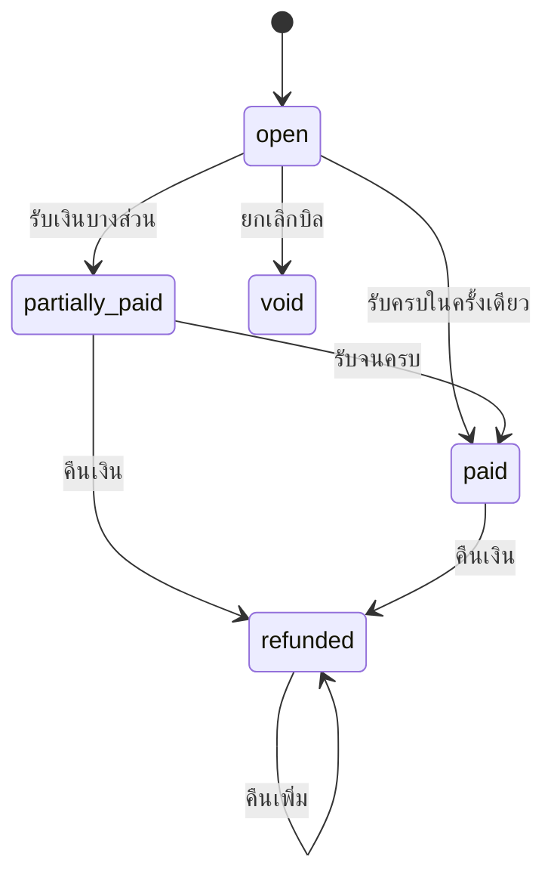

# ใบแจ้งหนี้และการเก็บเงิน

บิล (`invoice`) คือเอกสารที่บอกว่าลูกค้าต้องจ่ายอะไร เท่าไร ทุกอย่างเรื่องเงินผูกกับบิล ได้แก่ รายการ ส่วนลด การรับชำระ การคืนเงิน และใบเสร็จ ผู้ใช้หลักคือแคชเชียร์ที่เคาน์เตอร์ ส่วนสัตวแพทย์สร้างบิลทางอ้อมตอนปิดเคส

## บิลเกิดได้สองทาง

| ทาง | เกิดเมื่อไร | มีอะไรในบิล |
|---|---|---|
| อัตโนมัติตอนปิดเคส | `POST /staff/consultations/{id}/close` ใน transaction เดียวกับการปิดเคส | หัตถการ (`treatments`) ทุกรายการของเคส เรียงตามเวลาที่ทำ หัตถการที่ผูกกับบริการในแคตตาล็อกเป็นชนิด `service` ที่เหลือเป็น `treatment` ตามด้วยยาที่จ่ายแล้วระหว่างเคสเปิด เป็นชนิด `medicine` |
| ตอนจ่ายยาหลังปิดเคส | `POST /staff/prescriptions/{id}/dispense` ใน transaction เดียวกับการจ่าย | ค่ายาหนึ่งรายการ ลงบิลของเคสถ้ายัง `open` ออกบิลของเคสถ้ายังไม่มี หรือออกบิลใบใหม่ถ้าบิลของเคสรับเงินแล้วหรือถูกยกเลิก ดู [สต๊อกยาและเวชภัณฑ์](inventory.md#ค่ายาขึ้นบิลเดียวกับการรักษา) |
| สร้างเองที่เคาน์เตอร์ | `POST /staff/invoices` | รายการที่พิมพ์เอง เช่น ค่าฝากเลี้ยง อาหารสัตว์ หรือบิลที่ออกใหม่หลังยกเลิกบิลผิด |

- **เคสที่ไม่มีอะไรให้คิดเงินไม่มีบิล** คือไม่มีหัตถการและไม่มีค่ายาที่จ่ายแล้ว บิล 0 บาทเป็นเอกสารที่เคาน์เตอร์ต้องมาเปิดดูและเป็นแถวในรายงานรายได้โดยไม่มีประโยชน์
- **หนึ่งเคสมีบิลได้ใบเดียว** ปิดเคสซ้ำ (เช่น retry หลัง timeout) ได้บิลเดิมกลับมา การสร้างบิลเองที่อ้าง `consultation_id` ซึ่งมีบิลแล้วถูกปฏิเสธพร้อมเลขบิลเดิม ฐานข้อมูลกันซ้ำอีกชั้นด้วย unique index บางส่วนบน `consultation_id`
- **บิลต้องมีอย่างน้อยหนึ่งรายการ** ราคาต่อหน่วยติดลบไม่ได้ เพราะรายการติดลบคือส่วนลดที่หลบการอนุมัติ
- **สาขาของบิล** ถ้าไม่ส่ง `branch_id` ระบบใช้สาขาเดียวที่เปิดอยู่ ถ้าคลินิกมีหลายสาขาต้องระบุ
- **ราคาถูกบันทึกลงในรายการ** ไม่อ่านราคาปัจจุบันจากแคตตาล็อก บิลเก่าจึงพิมพ์ซ้ำได้ตรงเดิมแม้คลินิกขึ้นราคาภายหลัง
- **เพิ่มรายการได้เฉพาะตอนบิลยังไม่รับเงินและไม่ถูกยกเลิก** คือสถานะ `open` หรือบิล 0 บาทที่ยังไม่มีการรับเงิน (เช่น รายการแรกเป็นบริการที่แพ็กเกจครอบ) เมื่อรับเงินแล้วบิลคือยอดที่ตกลงกันแล้ว ของที่ลืมคิดให้ออกบิลใบที่สอง ไม่มี endpoint เพิ่มรายการในบิลที่มีอยู่ ทางเดียวที่บิลเดิมได้รายการเพิ่มคือค่ายาที่จ่ายหลังปิดเคส ซึ่งเปลี่ยนเวอร์ชันของบิลและเขียน audit `invoice.line_added` แคชเชียร์ที่ถือยอดเดิมอยู่จึงได้ `409 version_conflict` แทนการรับเงินผิดยอด

ชนิดของรายการ (`kind`) มี `service`, `treatment`, `medicine`, `other` ถ้าไม่ส่งเป็น `other` แยกไว้เพื่อให้รายงานกำไรต่อบริการหลังหักยาแยกค่ายาออกได้ ค่ายาจากการจ่ายยาเป็น `medicine` เสมอ และมี `source_id` เป็นรหัสใบสั่งยา

## สถานะ 5 แบบ

| ค่าที่เก็บ | หน้าจอแสดง | ความหมาย | รับเงิน | ส่วนลด | คืนเงิน | ยกเลิกบิล |
|---|---|---|---|---|---|---|
| `open` | ค้างชำระ | ยังไม่ได้รับเงินเลย | ได้ | ได้ | ไม่ได้ | ได้ |
| `partially_paid` | ชำระบางส่วน | รับเงินแล้วแต่ยังไม่ครบ | ได้ | ได้ | ได้ | ไม่ได้ |
| `paid` | ชำระแล้ว | รับเงินครบยอดรวม | ไม่ได้ | ไม่ได้ | ได้ | ไม่ได้ |
| `refunded` | คืนเงินแล้ว | มีการคืนเงินอย่างน้อยหนึ่งครั้ง | ไม่ได้ | ไม่ได้ | ได้ เพิ่มได้จนครบยอดที่รับ | ไม่ได้ |
| `void` | ยกเลิก | บิลที่ไม่ควรมีอยู่ตั้งแต่แรก | ไม่ได้ | ไม่ได้ | ไม่ได้ | ไม่ได้ |



**ไม่มีใครตั้งสถานะเอง** สถานะคำนวณใหม่จากตัวเลขเงินทุกครั้งที่มีการเคลื่อนไหว (`Invoice.Recompute`) ตามลำดับนี้ มีวันที่ยกเลิกเป็น `void` มีการคืนเงินเป็น `refunded` ยอดรับถึงยอดรวมเป็น `paid` รับมาบ้างเป็น `partially_paid` นอกนั้นเป็น `open` ออกแบบแบบนี้เพราะคอลัมน์สถานะที่ใครก็ตั้งได้ สักวันจะเขียนว่า `paid` ทับยอดที่ยังค้าง ส่วนการคำนวณทำให้สองอย่างนี้ขัดกันไม่ได้

- **คืนเงินบางส่วนก็เป็น `refunded`** contract วาดสถานะเป็นเส้นตรงและไม่มีสถานะ "จ่ายครบแล้วคืนบางส่วน" ถ้าย้อนกลับเป็น `partially_paid` บิลจะกลับไปอยู่ในรายการที่เคาน์เตอร์ต้องตามเก็บเงิน ทั้งที่คลินิกเป็นฝ่ายคืนเอง ดู `paid_satang` กับ `refunded_satang` เพื่อแยกคืนบางส่วนกับคืนทั้งใบ ([assumptions.md](../assumptions.md) ข้อ 22)
- **บิลที่ยอดรวมเป็น 0** (ลดเต็มจำนวน หรือทุกรายการราคา 0) กลายเป็น `paid` ทันทีทั้งที่ไม่มีการรับเงิน และออกใบเสร็จไม่ได้เพราะยังไม่มีการรับชำระ
- **ยอดค้างของลูกค้า** นับเฉพาะบิล `open` และ `partially_paid` บิล `partially_paid` ที่ถูกคืนเงินกลายเป็น `refunded` จึงหลุดจากยอดค้างแม้ `balance_satang` ยังมากกว่า 0

## เงินเก็บเป็นสตางค์

- ทุกยอดเป็นจำนวนเต็มหน่วยสตางค์ ตั้งแต่ request, DTO (`*_satang`), aggregate ไปจนถึงคอลัมน์ `bigint` ในฐานข้อมูล ไม่มี `decimal` ที่ไหนเลย `146000` คือ ฿1,460.00
- ฐานข้อมูลไม่มีคอลัมน์ยอดรวม ยอดรวมคำนวณใน aggregate เสมอ คำสั่ง UPDATE ที่เขียนมือจึงทำให้ยอดรวมกับรายการขัดกันไม่ได้
- DTO ส่งยอดทุกตัวมาให้ (`subtotal_satang`, `discount_satang`, `total_satang`, `paid_satang`, `refunded_satang`, `balance_satang`) หน้าเว็บไม่บวกเลขเอง เพื่อไม่ให้หน้าจอกับเซิร์ฟเวอร์เห็นยอดค้างไม่ตรงกัน
- หน้าเว็บแปลงเป็นบาทเฉพาะตอนแสดง (`formatBaht`) และแปลงสิ่งที่แคชเชียร์พิมพ์กลับเป็นสตางค์ด้วยการปัดเศษ (`parseBahtToSatang`) ไม่ตัดทิ้ง เพราะ 14.6 คูณ 100 ในทศนิยมของคอมพิวเตอร์ได้ 1459.999

## รับชำระ แบ่งจ่ายได้หลายช่องทาง

`POST /staff/invoices/{id}/payments` scope `payment:collect`

```json
{ "method": "card", "amount_satang": 106000, "reference": "APPR-552910" }
```

- **หนึ่งคำขอคือเงินหนึ่งก้อน** ลูกค้าจ่ายเงินสด ฿400 กับบัตร ฿1,060 คือสองคำขอ บิลเดินจาก `open` เป็น `partially_paid` แล้วเป็น `paid` เอง
- **ช่องทางมี 3 แบบตาม contract** `cash`, `card`, `promptpay` ไม่มีค่าเริ่มต้น ถ้าไม่ระบุจะถูกปฏิเสธ เพราะเดาว่าเป็นเงินสดทำให้ยอดในลิ้นชักผิด
- **`reference`** เลขสลิปจากเครื่องรูดบัตรหรือเลขอ้างอิงการโอน ใช้กระทบยอดตอนสิ้นวัน
- **จ่ายเกินยอดค้างไม่ได้** ตอบ `409 invalid_payment` เงินทอนจัดการที่ลิ้นชัก ไม่ใช่ในบัญชี
- **บิลที่ครบแล้วหรือยกเลิกแล้วรับเงินไม่ได้** ตอบ `409 state_conflict`
- **ต้องส่ง `Idempotency-Key`** ไม่ส่งได้ `400 idempotency_key_required` ส่งซ้ำด้วย key เดิมได้คำตอบเดิมโดยไม่รับเงินซ้ำ (เก็บไว้ 24 ชั่วโมง) ใช้ key เดิมกับเนื้อหาต่างกันได้ `409 idempotency_key_reused` หน้าเว็บสร้าง key ใหม่หนึ่งครั้งต่อเงินหนึ่งก้อน และใช้ key เดิมทุกครั้งที่ลองซ้ำ
- **ส่ง `If-Match` ได้** เวอร์ชันไม่ตรงตอบ `409 version_conflict` หน้าเว็บส่งทุกครั้ง

การปฏิเสธแบ่งเป็นสองแบบ รูปแบบคำขอผิด (ไม่มีเหตุผล ยอดติดลบ ช่องทางที่ไม่รู้จัก) ตอบ `422 validation_failed` ส่วนคำขอถูกรูปแบบแต่บิลรับไม่ได้ในสถานะตอนนั้น ตอบ `409` พร้อมรหัสของ domain คือ `invalid_payment`, `invalid_refund`, `invalid_discount`, `invalid_receipt`, `invalid_void` และ `state_conflict` ([assumptions.md](../assumptions.md) ข้อ 24)

## ส่วนลดต้องมีเหตุผลและผู้อนุมัติ

`POST /staff/invoices/{id}/discounts` scope `invoice:discount`

```json
{ "percent": 10, "reason": "ลูกค้าประจำ", "approved_by_staff_id": "stf_..." }
```

- ส่ง `amount_satang` หรือ `percent` อย่างใดอย่างหนึ่ง ส่งทั้งสองหรือไม่ส่งเลยถูกปฏิเสธ
- ส่ง `coupon_code` แทนเพื่อใช้คูปอง หรือ `points` เพื่อแลกแต้มสะสม สองแบบนี้ไม่ต้องส่งเหตุผลและผู้อนุมัติ ระบบเขียนให้ ดูหัวข้อ [แพ็กเกจ คูปอง และแต้มบนบิล](#แพ็กเกจ-คูปอง-และแต้มบนบิล)
- `reason` และ `approved_by_staff_id` บังคับทั้งคู่สำหรับส่วนลดที่ให้เอง ผู้อนุมัติเป็นช่องแยก ไม่ได้เอาจากคนที่กด เพราะคนกดมักไม่ใช่คนที่มีอำนาจอนุมัติ แถวส่วนลดเก็บทั้งผู้อนุมัติ (`approved_by_staff_id`) และผู้บันทึก (`applied_by_staff_id`)
- **เปอร์เซ็นต์คิดจากยอดก่อนส่วนลด** (`subtotal`) ไม่ทบจากส่วนลดก่อนหน้า และปัดลงเป็นสตางค์ ปัดขึ้นคือให้ส่วนลดเกินที่อนุมัติ ยอดที่คำนวณได้ถูกเก็บถาวร เปอร์เซ็นต์เก็บไว้แสดงอย่างเดียว ไม่คำนวณใหม่
- ให้ส่วนลดได้ตอน `open` และ `partially_paid` ส่วนลดรวมเกินยอดก่อนส่วนลดไม่ได้ และส่วนลดที่ทำให้ยอดรวมต่ำกว่ายอดที่รับมาแล้วไม่ได้ เพราะเงินที่ต้องคืนคือการคืนเงิน ซึ่งเป็นอีก endpoint และอีก scope
- **ข้อจำกัด** ระบบไม่ตรวจว่า `approved_by_staff_id` เป็นพนักงานที่มีอยู่จริง หรือมีสิทธิ์อนุมัติ ตารางไม่มี foreign key ไปที่พนักงาน ตอนนี้จึงเป็นการบันทึกว่าใครอ้างว่าอนุมัติ

## คืนเงิน

`POST /staff/invoices/{id}/refunds` scope `payment:refund`

- ทำได้เมื่อบิลเป็น `partially_paid`, `paid` หรือ `refunded` คืนหลายครั้งได้ แต่ยอดคืนรวมเกินยอดที่รับมาไม่ได้
- `reason` บังคับ หกเดือนต่อมา ความต่างระหว่างน้ำใจ บิลผิด และข้อพิพาท อยู่ในช่องนี้ช่องเดียว
- `payment_id` ไม่บังคับ เพราะบิลที่จ่ายเงินสดครึ่งบัตรครึ่งแล้วคืนทั้งใบคือการคืนหนึ่งครั้งต่อการจ่ายสองก้อน ถ้าระบุต้องเป็นการจ่ายของบิลนี้
- ช่องทางคืนเงิน ถ้าไม่ระบุ ใช้ช่องทางของ `payment_id` ถ้าไม่มี ใช้ช่องทางเดียวของบิล ถ้าบิลจ่ายหลายช่องทางใช้เงินสด คืนบัตรเป็นเงินสดทำได้แต่ต้องระบุเอง
- ต้องส่ง `Idempotency-Key` เหมือนการรับชำระ

## ใบเสร็จออกครั้งเดียว

`POST /staff/invoices/{id}/receipt` scope `receipt:issue`

- **บิลหนึ่งใบมีใบเสร็จหนึ่งใบ** กดซ้ำได้เอกสารเดิมกลับมา ตอบ `200` แทน `201` ไม่ออกเลขใหม่ ต้นฉบับใบกำกับภาษีสองใบเป็นปัญหาทางบัญชีของคลินิก ฐานข้อมูลกันซ้ำด้วย unique index บน `receipts.invoice_id`
- ออกได้เมื่อมีการรับเงินอย่างน้อยหนึ่งครั้งและบิลไม่ใช่ `void` ยอดในใบเสร็จคือยอดที่รับมาแล้ว ณ ตอนออก ถูกเก็บไว้ ไม่คำนวณใหม่
- **ระวังการแบ่งจ่าย** ใบเสร็จออกได้ตั้งแต่บิลยัง `partially_paid` ถ้าออกหลังรับเงินก้อนแรก ใบเสร็จจะมียอดแค่ก้อนแรก และออกใบใหม่สำหรับยอดที่รับภายหลังไม่ได้ ควรรับเงินให้ครบก่อนออก
- **ใบกำกับภาษี** ส่ง `is_tax_invoice: true` พร้อม `tax_id` (บังคับ) `legal_name` และ `billing_address` หน้าเว็บบังคับครบทั้งสามช่อง
- หลัง transaction commit ระบบส่งข้อความ `receipt.issued` ถึงลูกค้า ส่งไม่สำเร็จไม่ทำให้การออกใบเสร็จล้ม ตอนนี้ช่องทางส่งยังเป็น stub ดู [การแจ้งเตือน](notifications.md)

## ยกเลิกบิล

`POST /staff/invoices/{id}/void` scope `invoice:write` (endpoint ส่วนขยาย ไม่อยู่ใน contract)

```json
{ "reason": "ออกบิลผิดคน" }
```

- **ยกเลิกได้เฉพาะ `open`** คือบิลที่ยังไม่รับเงินเลย เมื่อรับเงินแล้ว การแก้คือคืนเงิน เพราะการยกเลิกจะลบร่องรอยของการรับเงินที่เกิดขึ้นจริง
- `reason` บังคับ บิลไม่ถูกลบ แถวยังอยู่พร้อมสถานะ `void` เหตุผล ผู้ยกเลิก และเวลา ฐานข้อมูลไม่มีการลบบิลเลย
- contract วาดสถานะ `void` ไว้แต่ไม่มี endpoint ที่ไปถึง ใช้ `invoice:write` แทนการตั้ง scope ใหม่ เพราะรายการ scope ของ contract ปิด scope ที่คิดเองจะไม่มี role ไหนถือ ([contract-extensions.md](../contract-extensions.md) ข้อ 3)

## อ่านบิล

| Endpoint | scope | ใช้ทำอะไร |
|---|---|---|
| `GET /staff/invoices` | `invoice:write` | รายการบิล ใหม่สุดก่อน กรองด้วย `status`, `branch`, `customer_id`, `from` (รวม), `to` (ไม่รวม) แบ่งหน้าแบบ cursor |
| `GET /staff/invoices/{id}` | `invoice:write` | บิลหนึ่งใบพร้อมรายการ ส่วนลด การชำระ การคืนเงิน ใบเสร็จ และ `ETag` |
| `GET /portal/invoices` | `portal` | บิลของลูกค้าเอง `?unpaid=true` คือบิลที่ยังค้าง |

- สองเส้นแรกเป็นส่วนขยาย contract มีแต่ `POST` หกเส้น บิลที่สัตวแพทย์ออกตอนปิดเคสจึงไม่มีทางให้แคชเชียร์หาเจอ ([contract-extensions.md](../contract-extensions.md) ข้อ 7)
- ใช้ `invoice:write` เพราะ contract ไม่มี `invoice:read` และ role ที่ถือ `invoice:*` คือคนที่ต้องเห็นบิลพอดี
- **สิทธิ์ระดับสาขา** พนักงานเข้าถึงได้เฉพาะบิลของสาขาที่ตัวเองสังกัด บิลสาขาอื่นตอบ `403` รายการบิลกรองสาขาใน repository พร้อมกับ cursor จึงไม่มีหน้าที่สั้นผิดปกติหรือ cursor ที่ชี้ไปบิลสาขาอื่น
- **ลูกค้าเห็นเฉพาะบิลของตัวเอง** กรองด้วย `customer_id` จาก token ที่ฐานข้อมูล บิลของคนอื่นตอบ `404` ไม่ใช่ `403` เพื่อไม่บอกว่าบิลนั้นมีอยู่

## ใครทำอะไรได้

| role ตั้งต้น | scope ด้านเงิน | ทำได้ |
|---|---|---|
| `cashier` | `invoice:*`, `payment:*`, `receipt:issue` | ทุกอย่างในเอกสารนี้ |
| `receptionist` | `invoice:collect` | ไม่มี endpoint ไหนใช้ scope นี้ จึงรับเงินและดูบิลไม่ได้ |
| `clinic_admin` | ทุก scope ยกเว้น `billing:payout` | ทุกอย่างในเอกสารนี้ |
| `clinic_owner` | `*` | ทุกอย่าง |

ความไม่ตรงกันระหว่าง `invoice:collect` กับ `payment:collect` ยังรอเจ้าของ contract ตัดสิน ([assumptions.md](../assumptions.md) ข้อ 3) รายละเอียด scope ดู [การให้สิทธิ์](../authorization.md)

## ประวัติการทำงาน

ทุกการเคลื่อนไหวของเงินเขียน audit log ใน transaction เดียวกัน `invoice.issued` (พร้อม `source` ว่ามาจาก `manual`, `consultation_close` หรือ `dispense`), `invoice.line_added`, `invoice.discounted`, `payment.collected`, `payment.refunded`, `receipt.issued`, `invoice.voided` แต่ละแถวเก็บยอดเงินและเหตุผลที่เกี่ยวข้อง ดู [audit log และความเป็นส่วนตัว](../security/audit-and-privacy.md)

## เลขเอกสาร

- บิล `INV-YYYYMM-NNNN` ใบเสร็จ `RCP-YYYYMM-NNNN` เช่น `INV-202608-0042` เลขรันเริ่มใหม่ทุกเดือน
- เดือนนับตามเวลาของคลินิก ไม่ใช่ UTC บิลตีหนึ่งของวันที่ 1 กันยายนที่กรุงเทพฯ คือวันที่ 31 สิงหาคมใน UTC และเอกสารที่ลงเดือนผิดคือเอกสารที่ยื่นภาษีผิดงวด
- ขอเลขภายใน transaction ของผู้เรียก ใช้ advisory lock ระดับ transaction กันแคชเชียร์สองคนได้เลขเดียวกัน บิลที่ rollback ไม่เผาเลข เพราะเลขเอกสารภาษีที่ขาดหายต้องอธิบายได้
- เลขบิลและเลขใบเสร็จเป็น unique ทั้งคลินิก

## หน้าเก็บเงินบนเว็บ

`/billing` เมนู **เก็บเงิน** ในหน้าจอพนักงาน เห็นเฉพาะบัญชีที่ถือ `invoice:write`

- **รายการบิล** ของสาขาที่เลือกอยู่ แท็บ ค้างชำระ (ค่าเริ่มต้น) ชำระบางส่วน ชำระแล้ว และทั้งหมด บิลคืนเงินและบิลยกเลิกดูได้ในแท็บทั้งหมด ปุ่มหน้าถัดไปใช้ cursor ตัวกรองอยู่ในที่อยู่ของหน้า (`/billing?status=&cursor=`)
- **ชื่อลูกค้า** อ่านจากทะเบียนลูกค้าซึ่งต้องใช้ `customer:read` แคชเชียร์ตาม role ตั้งต้นไม่มี scope นี้ จึงเห็นเลขบิลและยอดเงิน ไม่เห็นชื่อ
- **หน้าบิล** `/billing/<id>` แสดงรายการ ยอดรวม ส่วนลดพร้อมผู้อนุมัติ การชำระ และการคืนเงิน ด้านข้างมีการ์ด รับชำระ ส่วนลด ใบเสร็จ คืนเงิน และปุ่มยกเลิกบิล ชื่อผู้อนุมัติอ่านจากรายชื่อพนักงานซึ่งต้องใช้ `staff:read` ถ้าไม่มีจะแสดงเป็นรหัสพนักงาน
- **ชนิดของรายการ** แต่ละรายการมีป้ายเล็กหน้าชื่อ บอกว่าเป็น บริการ หัตถการ ยา หรืออื่น ๆ ค่ายาที่ห้องจ่ายยาเพิ่มเข้ามาเองจึงแยกออกจากค่าบริการได้ทันที
- **ฟอร์มรับชำระ** ขึ้นเมื่อบิลยังรับเงินได้และบัญชีถือ `payment:collect` ยอดเริ่มต้นเท่ายอดค้าง ลดลงได้เพื่อแบ่งจ่าย ช่องเลขอ้างอิงขึ้นเมื่อไม่ใช่เงินสด หลังรับเงินสำเร็จ ฟอร์มเริ่มใหม่จากยอดค้างใหม่และ key ใหม่
- **ใบเสร็จ** ปุ่มขึ้นหลังมีการรับเงิน ติ๊กเพื่อออกเป็นใบกำกับภาษี เมื่อออกแล้วการ์ดแสดงเลข เวลา ยอด และปุ่มพิมพ์ ตอนพิมพ์ ส่วนที่ติด class `no-print` (เมนู ฟอร์ม ปุ่ม) ถูกซ่อน
- **ยกเลิกบิล** ขึ้นเฉพาะบิล `open` และบัญชีถือ `invoice:write` ต้องพิมพ์เหตุผลก่อนยืนยัน
- ฟอร์มทุกอันเรียก server action ที่ตรวจรูปแบบข้อมูลด้วย zod แล้วเรียก API หนึ่งครั้ง การซ่อนฟอร์มตามสถานะและ scope เป็นเรื่อง UX เท่านั้น backend ตรวจซ้ำทุกคำขอ
- **สร้างบิลเอง** ปุ่ม **สร้างบิล** บนหน้ารายการ ไปที่ `/billing/new` ใช้ `invoice:write` สำหรับขายหน้าร้าน ค่าฝากเลี้ยง หรือค่าบริการที่ไม่ได้มาจากการปิดเคส
  - เลือกลูกค้าด้วยการค้นหาในทะเบียน (`GET /staff/customers?q=` ต้องมี `customer:read`) เลือกแล้วระบบดึงรายชื่อสัตว์ของลูกค้ามาให้เลือก ไม่บังคับ ถ้าบัญชีไม่มี `customer:read` ต้องพิมพ์รหัสลูกค้าเอง และเลือกสัตว์ไม่ได้
  - แต่ละรายการเลือกจากรายการสำเร็จรูปหรือพิมพ์เอง รายการสำเร็จรูปมีบริการของสาขา (จาก `GET /staff/services` ถ้าถือ `service:manage` ไม่อย่างนั้นใช้เมนูสาธารณะ `GET /services` ซึ่งมีเฉพาะบริการที่เปิดจองออนไลน์) และยากับเวชภัณฑ์ของสาขา (จาก `GET /staff/inventory/items` ถ้าถือ `inventory:read`) เลือกแล้วระบบเติมชื่อ ชนิด และราคาให้ แก้ได้ทุกช่อง เพราะบริการบางอย่างราคาต่างกันตามชนิดหรือน้ำหนักสัตว์
  - ยาจากคลังลงเป็นชนิด `medicine` เวชภัณฑ์อื่นเป็น `other` **รายการที่สร้างตรงนี้ไม่ตัดสต๊อก** API สร้างบิลรับแค่ชื่อ จำนวน ราคา และชนิด ถ้าหยิบของออกจากคลังจริงต้องบันทึกจ่ายออกที่หน้าสต๊อกด้วย หน้าจอเตือนเรื่องนี้ใต้รายการที่เป็นยา
  - ยอดรวมที่เห็นก่อนบันทึกเป็นยอดประมาณ ยอดจริงเป็นของ backend เมื่อสร้างแล้วหน้าจอเปิดบิลใบใหม่ให้รับเงินต่อ ไม่ได้ส่ง `consultation_id` เพราะบิลค่ารักษาออกเองตอนปิดเคสอยู่แล้ว
- **ส่วนลด** การ์ดขึ้นเมื่อบิลเป็น `open` หรือ `partially_paid` และบัญชีถือ `invoice:discount` กด **ให้ส่วนลด** เพื่อเปิดฟอร์ม
  - เลือกคิดเป็นจำนวนเงินหรือเปอร์เซ็นต์ พิมพ์เหตุผล และเลือกผู้อนุมัติ ค่าเริ่มต้นคือตัวเอง ถ้าถือ `staff:read` เลือกจากรายชื่อพนักงานของสาขาได้ ไม่อย่างนั้นใส่รหัสพนักงานเอง
  - ระหว่างพิมพ์ หน้าจอคำนวณส่วนลดแบบเดียวกับ backend (เปอร์เซ็นต์คิดจากยอดก่อนส่วนลด ปัดสตางค์ลง) และแสดงยอดรวมใหม่กับยอดค้างใหม่ ส่วนลดที่เกินยอดก่อนส่วนลด หรือทำให้ยอดรวมต่ำกว่ายอดที่รับแล้ว ถูกเตือนก่อนส่ง backend ตรวจซ้ำอีกครั้ง
  - ส่งพร้อม `If-Match` ถ้าระหว่างนั้นห้องจ่ายยาเพิ่มค่ายาเข้าบิล เวอร์ชันจะเปลี่ยนและได้ `409 version_conflict` หน้าจอโหลดบิลใหม่ทันที ฟอร์มยังเปิดค้างพร้อมค่าที่พิมพ์ และขึ้นข้อความว่าบิลเปลี่ยนไปแล้ว ให้ตรวจยอดใหม่แล้วกดอีกครั้ง
- **คืนเงิน** การ์ดขึ้นเมื่อบิลเป็น `partially_paid`, `paid` หรือ `refunded` มีเงินรับมาแล้ว และบัญชีถือ `payment:refund`
  - ยอดเริ่มต้นคือยอดที่ยังคืนได้ (รับมาแล้วลบที่คืนไปแล้ว) ลดลงได้เพื่อคืนบางส่วน มีปุ่มคืนเต็มจำนวน เลือกการชำระที่คืนได้ถ้าบิลรับเงินหลายก้อน เลือกช่องทางคืนได้ ถ้าไม่เลือก backend ใช้กฎเรื่องช่องทางด้านบน เหตุผลบังคับ
  - **ต้องกดสองครั้ง** กด **ตรวจสอบก่อนคืนเงิน** แล้วหน้าจอสรุปยอด ช่องทาง และเหตุผล ต้องกด **ยืนยันคืนเงิน** อีกครั้งเงินจึงออก หน้าสรุปบอกด้วยว่าบิลจะเป็น `refunded` ถาวร ถ้าบิลยัง `partially_paid` เตือนว่าจะเก็บเงินส่วนที่ค้างต่อไม่ได้อีก ([assumptions.md](../assumptions.md) ข้อ 22)
  - หลังคืนเงิน รายการคืนเงินและยอดคืนรวมขึ้นในบิล การ์ดใบเสร็จบอกว่าบิลนี้คืนเงินไปเท่าไร และใบเสร็จแสดงยอดที่รับชำระ ไม่หักเงินที่คืน และไม่ออกใบใหม่
- **idempotency key ของการคืนเงินและการสร้างบิล** สร้างใหม่หนึ่งครั้งต่อการคืนหรือต่อบิล ลองซ้ำหลังติดต่อระบบไม่ได้ใช้ key เดิม แต่ถ้าแก้ค่าในฟอร์ม หรือ backend ตอบปฏิเสธ หน้าจอสร้าง key ใหม่ เพราะ backend เก็บคำตอบทุกแบบที่ไม่ใช่ 5xx ไว้ใต้ key นั้น 24 ชั่วโมง ลองซ้ำด้วย key เดิมจะได้คำปฏิเสธเดิมกลับมา และ key เดิมกับข้อมูลใหม่ได้ `409 idempotency_key_reused`
- หน้าลูกค้า (`(portal)`) ยังไม่มีหน้าบิล

## แพ็กเกจ คูปอง และแต้มบนบิล

รายละเอียดอยู่ใน [แพ็กเกจ คูปอง และแต้มสะสม](crm.md) สรุปผลต่อบิลดังนี้

| เรื่อง | ผลต่อบิล |
|---|---|
| ขายแพ็กเกจ | `POST /staff/packages` ออกบิลหนึ่งรายการชนิด `other` (`source_id` เป็นรหัสแพ็กเกจ) ใน transaction เดียวกับการขาย audit `invoice.issued` มี `source: package_sale` แพ็กเกจใช้ได้เมื่อบิลนี้เป็น `paid` |
| ใช้สิทธิ์แพ็กเกจ | ตอนออกบิล (ปิดเคส หรือสร้างเองที่รายการ `service` มี `source_id` เป็นรหัสบริการ) ส่วนที่แพ็กเกจครอบเป็นรายการราคา 0 ชื่อมี "ใช้สิทธิ์แพ็กเกจ" ส่วนที่เกินคิดราคาเต็ม |
| คูปอง | ส่วนลดหนึ่งแถว เหตุผล "คูปอง โค้ด (ชื่อ)" ผู้อนุมัติคือคนสร้างคูปอง |
| แต้ม | ส่วนลดหนึ่งแถว 1 แต้มเท่ากับ ฿1 ผู้อนุมัติคือคนที่กด |
| ได้แต้ม | เมื่อการรับชำระทำให้บิลเป็น `paid` 1 แต้มต่อ ฿100 ที่จ่าย ปัดลง |
| คืนเงิน | หักแต้มคืนตามเงินที่คืน บิลขายแพ็กเกจที่ถูกคืนเงินทำให้แพ็กเกจเป็น `cancelled` สิทธิ์ที่ใช้ คูปอง และแต้มที่แลกบนบิลอื่นไม่คืน |
| ยกเลิกบิล | คืนสิทธิ์แพ็กเกจ การใช้คูปอง และแต้มที่แลกบนบิลนั้น บิลขายแพ็กเกจที่ถูกยกเลิกทำให้แพ็กเกจเป็น `cancelled` |

ทุกอย่างเกิดใน transaction เดียวกับการเคลื่อนไหวของเงินที่เป็นต้นเหตุ ผ่าน port `IInvoiceRewards` ที่โมดูล CRM เป็นผู้ทำ บิลกับแพ็กเกจ คูปอง และแต้มจึงไม่มีทางขัดกัน หน้าบิลมีโหมด "ใช้คูปอง" และ "แลกแต้ม" ในการ์ดส่วนลด และหน้าสร้างบิลส่ง `source_id` เป็นรหัสบริการเมื่อเลือกจากแคตตาล็อก

รายงานรายรับนับจากเงินที่รับจริงเหมือนเดิม เงินขายแพ็กเกจเป็นรายได้ตอนรับชำระ บริการที่ใช้แพ็กเกจเป็นรายการราคา 0 จึงไม่นับซ้ำ

## ข้อจำกัด

- **ยังไม่มี payment gateway** `PUT /staff/integrations/payment` ยังไม่ได้ทำ การบันทึกบัตรหรือ PromptPay หมายถึง "เครื่องรูดอนุมัติแล้วและเลขสลิปอยู่ใน `reference`" ไม่ใช่ระบบตัดบัตรเอง เมื่อมี gateway ต้องเรียกก่อน handler ไม่ใช่ข้างใน เพราะการเรียกเครือข่ายห้ามเกิดระหว่าง transaction ที่ล็อกแถวบิลอยู่
- **ลูกค้าจ่ายบิลค้างจากมือถือไม่ได้** ต้องใช้ gateway และ contract ไม่มี `POST /portal/invoices/{id}/payments` จึงไม่ได้คิด endpoint ขึ้นเอง
- **ค่ายาขึ้นบิลเฉพาะยาที่พบในคลัง** ยาที่ชื่อในใบสั่งยาไม่ตรงกับรายการในคลัง หรือรายการที่ราคาเป็นศูนย์ ไม่ถูกคิดเงิน ถ้าต้องเก็บค่ายานั้น ให้เพิ่มรายการชนิด `medicine` ตอนสร้างบิลเอง
- **บิลที่สร้างเองตัดสต๊อกไม่ได้** `POST /staff/invoices` ไม่มีช่องรหัสรายการในคลัง การขายยาหน้าร้านจึงต้องบันทึกสองที่ คือบิลกับการจ่ายออกในหน้าสต๊อก
- **แคชเชียร์ตาม role ตั้งต้นค้นลูกค้าและดูรายชื่อพนักงานไม่ได้** ไม่มี `customer:read` และ `staff:read` ตอนสร้างบิลต้องพิมพ์รหัสลูกค้า และตอนให้ส่วนลดต้องพิมพ์รหัสผู้อนุมัติถ้าไม่ใช่ตัวเอง
- **`billing:payout`** มีใน role แต่ไม่มี endpoint ใช้ ([assumptions.md](../assumptions.md) ข้อ 4)

## โค้ด

| ส่วน | ไฟล์ |
|---|---|
| aggregate และกฎเงิน | `backend/src/HappyPaws.Domain/Billing/Invoice.cs` |
| รายการ ส่วนลด การชำระ การคืนเงิน ใบเสร็จ | `backend/src/HappyPaws.Domain/Billing/` (`InvoiceLine.cs`, `InvoiceDiscount.cs`, `InvoicePayment.cs`, `InvoiceRefund.cs`, `Receipt.cs`, `InvoiceStatus.cs`) |
| use case | `backend/src/HappyPaws.Application/Billing/` (`CreateInvoice/`, `ApplyDiscount/`, `CollectPayment/`, `RefundPayment/`, `IssueReceipt/`, `VoidInvoice/`, `GetInvoice/`, `ListInvoices/`, `ListMyInvoices/`) |
| ออกบิลตอนปิดเคส และค่ายาตอนจ่ายยา | `backend/src/HappyPaws.Application/Billing/ConsultationBilling.cs`, `MedicineBilling.cs` |
| สิทธิ์ระดับสาขาและลูกค้า | `backend/src/HappyPaws.Application/Billing/InvoiceAccess.cs` |
| ชื่อสถานะและช่องทางบน wire | `backend/src/HappyPaws.Application/Billing/BillingWire.cs` |
| controller | `backend/src/HappyPaws.Api/Controllers/Staff/InvoicesController.cs`, `InvoiceTransactionsController.cs`, `backend/src/HappyPaws.Api/Controllers/Portal/PortalInvoicesController.cs` |
| เลขเอกสาร | `backend/src/HappyPaws.Infrastructure/Persistence/Repositories/Billing/DocumentNumberGenerator.cs` |
| ตารางและ index | `backend/src/HappyPaws.Infrastructure/Persistence/Configurations/Billing/` |
| เทสต์ | `backend/tests/HappyPaws.IntegrationTests/Api/Billing/`, `backend/tests/HappyPaws.UnitTests/Domain/Billing/InvoiceTests.cs` |
| หน้าเก็บเงิน | `frontend/src/app/(staff)/billing/`, `frontend/src/features/billing/` |
| สร้างบิลเอง | `frontend/src/app/(staff)/billing/new/page.tsx`, `frontend/src/features/billing/components/create/`, `actions/create-invoice-actions.ts`, `lib/load-catalogue.ts` |
| ส่วนลดและคืนเงิน | `frontend/src/features/billing/components/discount/`, `components/refund/`, `lib/discount-preview.ts` |
| ข้อความภาษาไทยของหน้าใหม่ | `frontend/src/features/billing/content/` |
| คำภาษาไทยของสถานะและช่องทาง | `frontend/src/features/billing/lib/invoice-labels.ts` |
| การแปลงสตางค์ | `frontend/src/lib/format/money.ts` |
